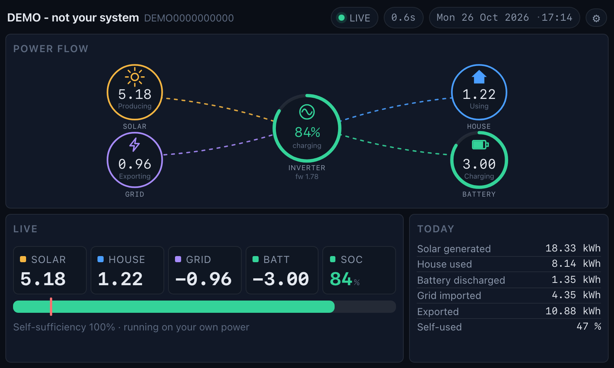
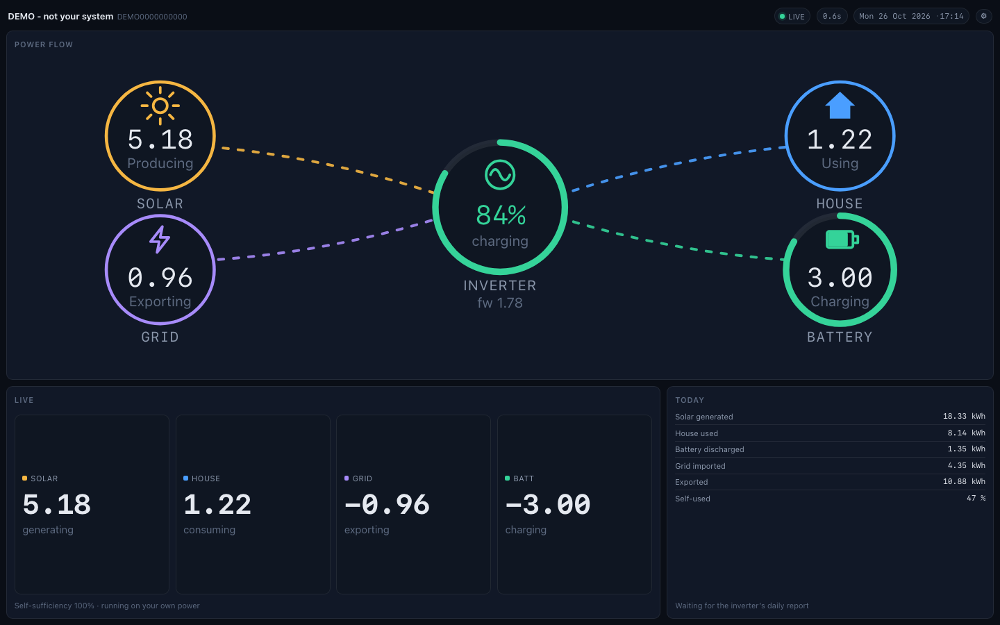
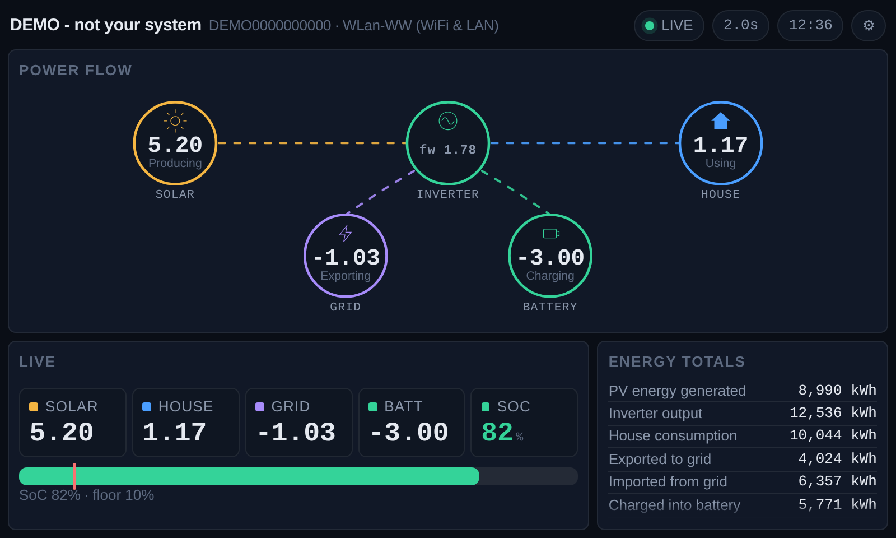
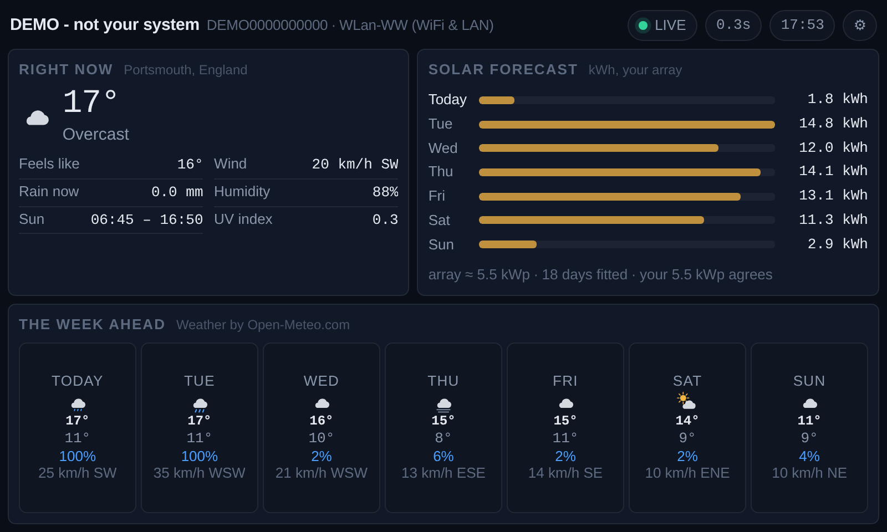

# FoxESS Dashboard

A standalone web dashboard for a FoxESS (Foxconn) solar installation.

- **Live power and SoC** from the FoxESS WebSocket — ~5 second resolution
- **Today's figures** from the FoxESS Open API production report — ~300 second resolution
- **Octopus Flux rates and meter readings**, when you have an API key
- **Settings page** for credentials and display preferences, persisted to disk
- **Export and import** the settings, so credentials are never retyped
- **Fits one screen** from 1440×900 down to 320×240, with no scrolling
- **Works on a phone** — a portrait layout of its own, which may scroll
- **Runs on a Raspberry Pi**, or drives an **ESP32 LCD** as a thin terminal
- **Runs in Docker** — one container, the settings mounted in from the host, `./update.sh` to update it
- **Updates itself** — a push to `main` publishes the image to a registry, and a Portainer stack redeploys itself from it
- **Zero dependencies** — Python standard library only, no `pip install`

## Screenshots

| | |
|---|---|
|  |  |
| **Rings** diagram — the default. Inverter in the middle, solar / house / grid / battery around it. | The same diagram on a larger screen. |
|  | |
| **Flow** diagram — the compact left-to-right alternative. | |
|  | |
| **Weather** slide — the conditions now, the daylight band, the solar forecast for your own roof, and the week ahead. | |

Switch between them in **Settings → Power flow diagram**, or set
`"display": {"diagram": "rings" | "flow"}` in `config.json`.
More at every screen size in [`docs/`](docs/).

The official Open API can only ever be as fresh as the datalogger's upload
cadence, which was measured at **exactly 300 seconds** on a real H1-G2
installation. The WebSocket bypasses that entirely and is the same endpoint the
FoxESS web dashboard uses.

---

## Quick start

### 1. Preview the UI with no credentials

```bash
python3 run.py --demo
# -> http://127.0.0.1:8765
```

### 2. Run it against your installation

```bash
export FOXESS_USER='you@example.com'
export FOXESS_PASS='your-password'
export FOXESS_API_KEY='your-open-api-key'

python3 run.py
```

Then open **http://<pi-ip>:8765/settings** and fill in your credentials — the
settings page is the recommended way to configure it, and it saves to disk so
it survives restarts.

The inverter serial number and power-station id are auto-detected from the
Open API, so you don't need to set them.

> **Prerequisite:** enable **Multi-device login** in the FoxESS web portal —
> Profile → System Settings → Advanced Settings. The WebSocket authenticates
> with a web-session token, not the Open API key.

### 3. Run it in Docker

```bash
mkdir -p config && cp config.example.json config/config.json
docker compose up -d --build
```

The settings file stays on the host and is mounted into the container, so
rebuilding never loses the credentials. The full guide — updating, rolling
back, and the Pi screens that read it over HTTP — is in
[`docs/DOCKER.md`](docs/DOCKER.md).

---

## The settings page

`/settings` — linked from the ⚙ in the dashboard header.

| Section | What you can set |
|---|---|
| **Power flow diagram** | which style the big diagram is drawn in — rings or flow |
| **FoxESS account** | email, password, Open API key, region domain, inverter SN, plant id |
| **Data sources** | enable/disable the live feed and the totals, poll interval |
| **Octopus Energy** | API key, account number, tariff — and **Save and test**, which checks them and fills the rest in |
| **Weather & solar forecast** | the place, the roof's tilt and azimuth, the units, the performance ratio and the array size |
| **Slides** | which slides to show, in what order, and how often |
| **Display** | theme (dark/light/auto), power units (kW/W), clock format, timezone, layout, fallback poll interval, panel visibility |
| **Detected** | live readout of what the cloud reports — serial, plant, datalogger, firmware, battery units, min SoC, the Octopus meters, and how the daily figures compare |

Changing the credentials re-wires the live connections immediately — no
restart needed. Changing a display setting applies instantly to every
connected screen, including the ESP32, because settings travel with every
snapshot.

**Secrets are never sent back to the browser.** The API returns a mask; leaving
a secret field blank keeps the stored value. The settings file is written with
`0600` permissions. The one exception is the deliberate **Export** button,
which hands over the whole file — see [Keeping your credentials](#keeping-your-credentials).

---

## Two ways to draw the power flow

The dashboard ships with two diagram styles, switched from the settings page
(**Settings → Power flow diagram → Style**):

**Flow** — the linear diagram: solar on the left, the inverter in the middle
feeding the house, with the grid and the battery branching off below. The
nodes are rings in the same language as the rings diagram — icon, value and
status inside — so the two themes look like one family.

### The Live panel follows the diagram

On a large screen the Live panel shows **what the diagram does not**, so the
two never say the same thing twice:

| | Flow diagram | Rings diagram |
|---|---|---|
| The panel | a battery **ring** on the left, four stats in a 2×2 grid | four large stats across the full width |
| The battery level | in the panel — the diagram has none | in the diagram — the hub and the ring around the battery node |

The ring is a full circle in the same language as the diagram's, coloured by
the health of the pack, with a tick at the inverter's minimum. On the small
panels both diagrams fall back to the compact number strip.

Both themes give the diagram the full width of the top row, so a linear
diagram gets a panel it can actually fill rather than a stamp in a corner.
The self-sufficiency line appears once, in whichever panel is not already
showing something else.

**Rings** — a hub and its satellites, the way Home Assistant draws it. The
inverter sits in the middle, with solar, house, grid and battery around it.
Each node has an icon, a coloured ring, the live value, and what it is doing
right now. The flow lines are dotted and carry moving dashes in the direction
the power is actually going, and a line only appears when there is power on
it — so an idle system stays calm instead of flickering.

The hub's ring is a little bigger than the four around it, and the level in
the middle is the biggest number on the diagram — the inverter is the centre
of it, and that is where the eye should land first.

**The battery level is a ring.** The hub and the battery node both show the
state of charge as an arc that fills clockwise from the top, and the colour
tells you how healthy the pack is:

| State | Colour | Meaning |
|---|---|---|
| 40 % and above | green | comfortably charged |
| below 40 % | amber | getting low |
| at or below the inverter's own minimum | red | the grid is taking over |

One helper decides the colour, and everything follows from it: the two ring
arcs, the big percentage in the middle, the battery icon, the SoC gauge, the
SoC bar and the SoC tile. The battery icon fills up to the level as well.

Self-sufficiency moves down into the LIVE panel in this style, because the hub
is busy showing the battery.

| Style | 800×480 |
|---|---|
| Flow | values at 27 px, one row of nodes |
| Rings | values at 25 px, a hub and four rings — the hub's level at 31 px |

Both styles are checked at every viewport size by `layout_check.py`, so
neither can quietly break the other.

### Which way do the dashes move?

The moving dashes on a wire show which way the power is going. What makes
this fiddly is that the two diagrams draw their wires differently:

| Wire | Linear | Rings |
|---|---|---|
| solar | solar → inverter | solar → hub |
| house | inverter → house | hub → house |
| grid | inverter → grid | grid → hub |
| battery | inverter → battery | hub → battery |

The dashes always travel *along* the path as drawn, so the grid wire has to
be reversed when importing in the linear diagram but when exporting in the
rings one, and the battery wire has to be reversed while discharging in both.

### Which way do the wires bend?

In the rings diagram the four wires do not all curve the same way. **Solar
and house bow away from the hub's horizontal axis**, while **grid and battery
bow towards it**, so the diagram reads as two mirrored pairs rather than four
wires sagging together.

The bend is a property of the path, not of the animation — it does not change
which way the dashes travel, only the shape of the wire they travel along.
`tests/test_diagram.py` measures it out of the markup and checks that the
two pairs stay opposite, that the diagram stays mirror-symmetric about the
hub, and that every wire still lands on its node's ring.

Two checks guard this:

```bash
python3 flow_direction_check.py       # in a real browser: measures the
                                       # rendered animation against the
                                       # power flow, in 6 states
python3 -m unittest discover -s tests  # reads the path geometry out of the
                                       # markup and checks the conditions
```

---

## Slides

The dashboard rotates through a list of views, so one screen can show more
than one thing:

| Slide | What it shows |
|---|---|
| **Power** | the diagram, the live figures and today's totals |
| **Usage** | the half-hourly grid import and export chart, the Octopus rates and today's totals |
| **Weather** | the conditions right now, a seven-day solar forecast for your own roof, and the week ahead |

The **server** owns which slide is showing, so the Pi screen, a phone and
anything else open on it show the same slide at the same moment. The slide
*list* and the *interval* live in the settings; the current slide is kept in
memory, so the settings file is not rewritten every time the display moves.

The ESP32 client ignores the rotation and keeps showing its compact summary.

Set the list, the order and the interval in **Settings → Slides**. `0` turns
the rotation off.

### How the slide changes

The slide change is a card dealt onto a deck. The slide that is leaving is
copied and left on screen behind the one that is arriving, so it is not
blanked out first — it dissolves underneath while the new slide sweeps in
over it from the right, throwing a shadow onto the copy as it goes.

The **header does not move**. It sits outside the slide altogether, which is
also why it is the right place for the clock and the date: it is the one
part of the dashboard that stays put while everything below it changes.

### Swiping between the slides

The dashboard is on a touch screen, so a **sideways swipe turns the deck**:
swipe left for the next slide, right for the one before. The rotation
wraps round at both ends, so the order is the same whichever way it is
entered from.

The gesture is measured rather than guessed. It has to travel at least 60
pixels sideways, and further sideways than up and down, or it is a tap and
not a swipe. A swipe that starts on a button is left alone, so the gear in
the corner still opens the settings.

The slide arrives from the side it was swiped from — the next one comes in
from the right, the one before from the left — and it is shown **straight
away**, rather than waiting for the server's answer to come round the loop.
The server has the last word: if it says something different, the slide
changes again.

A slide you have swiped to is not taken away from you a moment later: it
gets the full rotation interval, and the rotation carries on from there.

### The header carries the date

The clock shows the time and the date together:

```
Your plant  1B2C3D4E5F60   [LIVE] [0.2s] [Tue 27 Oct 2026 · 09:44] [⚙]
```

The header carries the station identifier — the plant's name and the
inverter's serial. The datalogger's model (`WLan-WW (WiFi & LAN)`) is
not much use up there; it is in the system panel, where there is room
for it.

The header is one line, so on the smallest screens the plant details
go before the plant name — the name is what matters.

The **cog** at the end is the way to the settings page. It is small on
purpose, but it has to be easy to hit on a touch screen, so the
picture is a little bigger than it was and the target is bigger than
the picture.

## Weather and the solar forecast

The **Weather** slide shows the conditions right now, a seven-day solar
forecast for your own roof, and the week ahead. The weather comes from
[Open-Meteo](https://open-meteo.com), which needs no API key for personal
use — the credit on the slide is all that is asked for. It is polled every
fifteen minutes, which is as often as a forecast changes much.

Set the place in **Settings → Weather & solar forecast**. Type a town and
press **Find**; the gazetteer only knows towns and villages, so a hamlet
or a street will not be found — use the town nearby. The latitude and
longitude are filled in for you, and **Save and test the forecast** says
what came back *and saves it*, so the slide starts working straight away.

### The daylight band

The RIGHT NOW panel carries a strip of the whole day, from midnight to
midnight, with the twilight either side of the sun and a bead on it
showing where the sun is now:

```
DAYLIGHT                    9h 55m · 5h 22m of daylight left
▓▓▓▓▓░░▒▒▓▓▓▓▓▓▓▓▓▓▓▓▓▓▓▓▓▓▓▓▓▓▓▓▓▓▓▓▓░░▒▒░░▓▓▓▓▓
     06:47 sunrise                    16:42 sunset
```

The colours are the light: black for the night, then the three
twilights — astronomical, nautical and civil — and then the amber of
the day.

The forecast gives sunrise and sunset, but not the twilight around them,
so that is worked out locally by `foxess/sun.py` — the standard solar
position formula, and nothing outside the standard library. The times it
works out were checked against the forecast service's own sunrise and
sunset for ten places and days, from Welwyn Garden City to Sydney to
Reykjavík: the worst difference is under three minutes, and usually
under one.

The times are in the plant's own timezone, not the browser's, and they
follow the server's clock, so they agree with the clock at the top of
the screen. Where the sun does not rise — inside the polar circles, or
at the height of a polar night — the band is left off rather than
guessed at, and so is it on the smaller screens, where there is no room
for it.

### The units you chose

**Temperature** and **Wind speed** are carried through to the slide. The
forecast is fetched in the unit you asked for, so the numbers *are* in
that unit, and the slide labels them with it:

| You chose | The slide says |
|---|---|
| Celsius | `17°C` |
| Fahrenheit | `63°F` |
| Kilometres per hour | `20 km/h` |
| Metres per second | `5.6 m/s` |
| Miles per hour | `12 mph` |
| Knots | `10 kn` |

The weather service writes its units in its own way — it calls miles per
hour `mp/h` — so the unit cannot be worked out from the reply; it is
taken from the settings and carried the whole way through.

### The array's size, worked out from your own yield

The forecast knows how much sun lands on the roof. It does not know how
much of that your particular array collects — that depends on the panels,
the angle, the dirt, the heat and the inverter. So the dashboard measures
it:

```
system factor  =  the kWh your inverter made  ÷  the kWh per m² of sun that fell
```

The yield comes from the inverter, in one of two ways:

- **The FoxESS production report** — the same daily PV figure the Fox app
  shows. It is the better source, and it is used whenever it is there.
- **The live feed.** The WebSocket carries the solar power, so integrating
  it over the day gives that day's yield. This works *without* the Open
  API, and it is what the fit uses when the report is not available.

The sun comes from the forecast's *global tilted irradiance* for those same
days. The two are compared day for day over the last three weeks, and the
**median** of the daily ratios is the system factor. The median, so that
one odd day does not throw the whole thing out.

That factor is what turns tomorrow's forecast into tomorrow's yield:

```
tomorrow's kWh  =  tomorrow's kWh per m² of sun  ×  the system factor
```

The size of the array in **kWp** follows from it, by dividing by the
performance ratio — the share of the sun the array collects once the
inverter, the cabling, the heat and the dirt have taken their cut:

```
kWp  =  the system factor  ÷  the performance ratio
```

The performance ratio (0.85 by default) is an **assumption**, so the kWp is
an **estimate**; the system factor itself is a **measurement**. Both are shown
in the Detected table on the settings page, along with the days that went
into them, and how today's half-day is comparing with the fit.

> If you know the size of your array, put it in **Array size (kWp)**. It
> is optional — the dashboard works it out for itself — but then the fit
> can be checked against it, and the **performance ratio measured rather
> than assumed**: the factor divided by your real kWp.

> The window reaches back past the turn of the month, so the fit does not
> reset on the first of every month — the month before is fetched once and
> kept.

### The roof

The forecast's sun is for a plane at a given **tilt** and **azimuth**, so
the settings have both. Azimuth 0 is **south**, and Open-Meteo counts
anticlockwise from there, so +90 is west and −90 is east. A tilt of about
35° collects the most in Britain.

### Before it has been fitted

Until there are enough days to compare, the panel shows the sun in kWh/m²
rather than a yield it cannot stand behind, and says so. The Detected
table says how many days have gone into the fit so far.

---

## Octopus Energy

An optional integration for Octopus customers. Two things are read:

- **The tariff rates** — public, no API key needed. For Octopus Flux that
  means the import and export rate for the current half hour, and which band
  you are in.
- **Your meter** — the half-hourly import and export readings, and what they
  cost. This needs an API key.

Flux has three bands, in UK local time: **super cheap 02:00–05:00**, the
standard rate, and **peak 16:00–19:00**. The export rate at peak is several
times the cheap-window rate, so the dashboard says when it is worth
discharging the battery.

The API key goes in **Settings → Octopus Energy**, together with your account
number — the meter point and meter serial are looked up from it, so it is the
only thing you have to find. The key is stored on the machine with `0600`
permissions and never leaves it. **Save and test** checks the credentials
straight away, saves them, and fills the fields in with what it found.

> Most homes measure their export with the inverter, not with a second
> meter register, so there is no export MPAN to find. The Detected table
> on the settings page says whether your account has one.

**When the meter has no readings for today** — Octopus only gets them
when the meter sends them, which can be a day or two behind — the
inverter's own figures are used instead and marked as an estimate. Each
direction is taken from the meter when the meter has something to say,
and from the inverter when it does not.

> The Octopus meter measures the **grid boundary**, so its "consumption" is
> your grid import, not your house usage. The chart on the Usage slide
> shows the grid, in both directions: the import above the line and the
> export below it. The house's own use is in the Today row underneath,
> because it does not move when the battery covers the house — which is
> exactly what you would not want to see on a chart about your tariff.

---

## The Octopus Mini

If you have an **Octopus Mini** — the little device that reads your meter
itself — the dashboard can show **live** figures instead of waiting for
Octopus to collect the half-hourly readings, which can be a day or two
behind.

The Mini's data comes from Octopus's **GraphQL** API. The good news is
that the **API key you already have gets a session token on its own** —
there is nothing extra to enter.

If the API key is not accepted, the account's **email and password** are
tried instead, but that route sometimes wants a CAPTCHA as well, so it
only works for some accounts. The email and password fields are
therefore optional, and the password is stored like the other secrets and
is only ever used to get a token.

The readings themselves come from three GraphQL calls:

| Call | What it is for |
|---|---|
| `obtainKrakenToken` | a session token, from the API key |
| the account's meter | `smartImportElectricityMeter.deviceId` — the smart meter's own id |
| `smartMeterTelemetry` | the readings, grouped ten seconds, one minute, five minutes, half hourly or hourly |

> Octopus retired the old `octocareUsageInfo` query in April 2026 — the
> Octopus Care feature behind it is no longer supported, and it now
> answers "Account is not currently supported."  The device id comes
> from the meter instead, which is how the Home Assistant integration
> does it.

> The Octopus API allows about a hundred calls an hour for the whole
> account, shared with the Octopus app, so the Mini is polled every two
> minutes and the half-hourly readings every five. If the Mini cannot be
> reached the poll backs off, so a broken Mini cannot eat the whole
> allowance.

What it adds to the **Usage** slide:

| | |
|---|---|
| **● 0.42 kW now** | the power the meter is showing right now, in the panel header |
| **Imported / Exported** | today's figures from the meter's own counters, so they are not a day behind |
| **Cost today** | what you have spent today, counted by the meter rather than guessed from the inverter |

The meter's counters are cumulative, so today's energy is the difference
between the counter now and the counter at local midnight. The counters
also cover the **export** direction, which the half-hourly API does not
give you unless your account has a separate export meter point.

Everything here is optional: without the Mini the slide falls back to the
half-hourly readings and the inverter's own daily register, exactly as
before.

---

## The usage chart

The chart on the **Usage** slide is a timeline of the last 24 hours, with
**the grid** in it:

- **import above the line** — what you took from the grid
- **export below the line** — what you put back
- the shaded **cheap** (02:00–05:00) and **peak** (16:00–19:00) windows

It is the grid, because that is what the tariff is about. The house's
own use is in the Today row underneath instead: it does not move when the
battery covers the house, so a chart of it would look the same whether
you were running on solar or on the grid.

The panel says **where the numbers came from** — "from your Octopus
meter" when the Mini's readings cover the chart, and "from the inverter"
otherwise — so there is never any doubt about what you are looking at.

### Checking the numbers

Two figures are printed on every poll and in the settings page:

```
mini: 4.21 kWh imported today, the biggest half hour 2.71 kWh at 02:00
  against the inverter: 4.08 kWh (difference +0.13 kWh)
```

The **biggest half hour** is the largest amount of energy the meter saw
cross the grid boundary in one half hour. If that does not match the
Octopus app, the chart is wrong and the difference is worth chasing.

The second line compares the meter's total for the day with the
inverter's own count of the grid. They measure the same thing by two
different routes, so they should be close; a large difference means one
of them is.

> The inverter and the meter do not count quite the same thing — the
> inverter sees what flows through its current transformers, the meter
> sees the whole grid boundary — so a few per cent is normal, and a
> large gap is not.

Where the two sources overlap, the **meter wins** — the Mini's own
half-hourly readings are what crossed the grid boundary, so they are used
in preference to the inverter's estimate of the same thing.

The scale says what the bars are. The chart is normally half-hourly,
drawn from the half-hourly history the dashboard records itself. Until
that history has filled the whole day — which takes a day of the
dashboard running — the bars come from the inverter's hourly report
instead, and the scale says "kWh per hour" rather than "kWh per half
hour": an hour's energy is twice a half hour's, and drawing it as a
half hour would double it.

---

## Today's figures

The **Today** panel on the Power slide, and the Today row on the Usage
slide, come from the inverter's own **production report** — the same
register the Fox app reads.

Two things are worth knowing about it:

- The report is asked for by **month**, which gives one value per day of
  the month, and by **day**, which gives one value per hour. The month
  report is used for the day's figures, because the daily one is known
  to be a little wrong at the edges of the day.
- It has **two solar figures**: `generation`, which is the inverter's AC
  output — for a hybrid that includes what the battery sent out — and
  `PVEnergyTotal`, which is the PV yield. **The PV yield is the one the
  Fox app shows**, and that is the one the dashboard uses.

The two are cross-checked against each other on every poll, and the
result is printed to the console and shown on the settings page:

```
daily report: pv 0.20, house 1.10, grid_in 0.90, ...
  pv: month 0.20 vs hours 0.20 (difference +0.00)
  pv yield: month 0.20 vs hours 0.20 (difference +0.00)
  pv from the live feed: 0.24 kWh (difference -0.04)
  balance: +0.02 kWh
```

The **balance** is the sun, the battery and the grid coming in, less the
house, the battery and the grid taking out. It should be near zero —
what is left over is the battery's own losses.

> The daily figures are also cross-checked against the half-hourly
> history the dashboard records itself, so a disagreement between the
> inverter's registers and the live feed shows up rather than being
> taken on trust.

### Yesterday, for comparison

Under each figure on the **Today** panel is yesterday's figure for the
same thing, in a smaller and quieter hand — the word on one line, the
number and its unit on the next:

```
SOLAR              HOUSE             BATTERY
10.15 kWh          4.29 kWh          0.53 kWh
yesterday          yesterday         yesterday
12.38 kWh          3.92 kWh          0.72 kWh
```

The energy figures come out of the inverter's own register — the same
monthly report that today's figures come from, read one day further
back — so they do not depend on the dashboard having been running.
Yesterday's cost comes from the Octopus Mini, which keeps a day or two
of its own half-hourly readings.

Yesterday is a **whole day** and today is not, so today will usually be
the smaller of the two numbers until the evening. That is what the
figures are: it says where the day has got to, against the whole of the
day before it.

Where there is no yesterday to compare with — the meter has forgotten
it, or the inverter has not reported it — the line is simply left out
rather than filled in with something that is not there.

---

## Keeping your credentials

Typing an API key into a settings page on a touchscreen is no fun, and
you should not have to do it twice. The settings page has:

| Button | What it does |
|---|---|
| **Copy the API key** | Puts the Octopus API key on the clipboard |
| **Copy the account number** | Puts the Octopus account number on the clipboard |
| **Export** | Downloads the whole settings file, secrets included |
| **Import** | Reads a settings file and fills the form in |

Export asks first, because the file it writes contains your API key and
your FoxESS password in plain text. Import fills the form in but does
not save it — press **Save settings** to keep it.

---

## Display targets

| Target | Needs | See |
|---|---|---|
| **Raspberry Pi + LCD** | Chromium, an LCD | [`display/README.md`](display/README.md) |
| **ESP32 + SPI LCD** | MicroPython, a panel | [`display/README.md`](display/README.md) |
| **A phone** | a browser | [On a phone](#on-a-phone) |

The architecture is the same for both: **the server runs on the host** — a
container on a server, or a process on a Pi — and holds the WebSocket session,
TLS and credentials. The displays are just terminals: the Pi follows
`/events` (SSE), the ESP32 polls `/api/state`, so none of that has to fit in
320 KB of RAM.

```
  ESP32 + LCD  ──► /api/state  ──┐
                                 ├──► dashboard server (the container)
  Pi + LCD     ──► /events (SSE) ─┘
```

---

## One screen, no scrolling

**The target is a Raspberry Pi 3 with the official 7" touch display, 800×480.**
The layout has a dedicated breakpoint for exactly that panel, so the type can
be sized for it rather than compromised for a range of unknown screens:

| Size | Layout |
|---|---|
| **800×480 (the target)** | diagram across the full width, live tiles and totals below; body 15 px, tile values 24 px, diagram values 27 px (flow) or 25 px with a 31 px hub (rings) |
| ≥ 1000×600 | flow diagram + gauge, totals and system panels below |
| ~480×320 (3.5" LCD) | numbers only — the diagram is unreadable at this size |
| ~320×240 (2.8" LCD) | one row of five tiles plus the SoC bar |

Verify it against your actual panel:

```bash
python3 layout_check.py          # needs playwright
```

It asserts, at ten viewport sizes, that:

- `scrollHeight <= clientHeight` — no page scrolling
- every value is fully on screen, and **no number is truncated** (a value
  silently ellipsised to `GRID -0…` still "fits", so it needs its own check)
- **type stays legible** — body ≥ 12 px, headings ≥ 10 px, tile values
  ≥ 15 px, and the rendered SVG label/value heights are measured, not assumed

That last check is the important one. The layout adapts by *dropping content*
first — the diagram on small panels, the captions, the optional rows — and only
then by adjusting the grid. It never buys space by shrinking the text into
illegibility.

---

## On a phone

A phone in portrait is 390×844 — narrower than the Pi's panel and much taller.
It used to fall through the small-screen breakpoints and get the leftovers: the
diagram dropped, today's figures dropped, the Octopus figures dropped, the
solar forecast dropped, and 13 px text. It was the Pi with the interesting
parts taken out.

A phone now has a layout of its own, in one deliberately narrow media query:

```css
@media (max-width:560px) and (min-height:600px){ ... }
```

Both halves matter. The width excludes the Pi, the small LCDs, the ESP32 and
the narrow 320×480 panel; the height excludes anything wide but short. No
display that exists today can match it, and `tests/test_phone_layout.py` says
so.

| | what the phone gets |
|---|---|
| **Power** | the battery ring beside the four live figures, today's figures as a table underneath |
| **Usage** | the chart, the Octopus figures and today's tiles |
| **Weather** | the conditions, the solar forecast and the week |
| **The diagram** | dropped — its own type comes out at 11 px at this width |
| **Type** | body 14 px, figures 26 px |

**A phone may scroll.** The "one screen, no scrolling" rule above is for panels
that are screwed to a wall. A phone is held in a hand, so the slide is as tall
as its content and the stage scrolls it — the bottom of it is reachable. Where
the slide fits the screen there is nothing to scroll, and nothing missing.

**The swipe still turns the deck.** The browser is given the vertical pan and
keeps its hands off the horizontal one, so a sideways drag is still the
dashboard's. The gesture code is no different on a phone — the same 60 px, the
same sideways slop — and a phone shows the same slide as the Pi at the same
moment, because the server owns the slide.

`layout_check.py` knows about the phone and enforces **higher** floors for it
than for the fixed panels (body 14 px, figures 20 px): a phone is read closer
than a panel on a wall.

The investigation, the measurements, and the two alternatives that were not
taken are in [`docs/MOBILE.md`](docs/MOBILE.md).

---

## Running on a Pi 3

The Pi 3 is a 1.2 GHz Cortex-A53 with 1 GB of RAM, so the dashboard is built
to do as little work as possible per update:

- **Live data arrives over Server-Sent Events**, not polling — the fallback
  poll only runs while the event stream is down
- **The DOM is built once.** Tiles and table rows are created on the first
  snapshot; afterwards only cells whose value actually changed are written.
  Measured: **0 `innerHTML` writes** during continuous updates
- **Only active wires animate** — the dash-offset animation is removed from
  any path carrying no power, so an idle system costs nothing

See [`display/README.md`](display/README.md) for the kiosk setup, systemd unit
and Pi-specific Chromium flags.

---

## Running in Docker

The dashboard is standard library only, so the container is the official
Python image plus the timezone database — there is nothing to install and
nothing to compile.

```
  Pi screen(s) ──HTTP──►  the container  ──HTTPS──►  FoxESS / Octopus
                         │  reads
                         ▼
                   ./config/config.json
```

**The settings file is never in the image.** It lives in `./config` on the
host and is mounted in, so a rebuild cannot lose it and a built image cannot
leak it.

```bash
mkdir -p config && cp config.example.json config/config.json
chmod 600 config/config.json

docker compose up -d --build
```

The container runs as uid 1000 — the first ordinary user on Raspberry Pi OS —
and answers `/healthz`, so Docker knows when it is up. The same image serves
a hosted Intel server, a Pi and a laptop: it builds for `amd64`, `arm64` and
`arm/v7`, and nothing in the dashboard is architecture-dependent.

### Updating

```bash
./update.sh
```

Pull the newest code, build it, tag the image that is running now as
`:previous`, put the new one in place, and wait for it to answer. If it does
not come up, the old image goes back and the log says why. A failed build
never touches the container that is running.

### The screens

The Pi screens are clients: a browser and an address.

```bash
python3 display/pi_kiosk.py --url http://<host-ip>:8765 --no-server
```

### The catch

**The dashboard has no authentication.** Anything that can reach the port can
read the page, change the settings and ask for the credentials in plain
text. Keep it on the LAN — do not publish the port. The settings file has
the FoxESS password and the API keys in it; keep it `0600` and out of git.

The whole guide is in [`docs/DOCKER.md`](docs/DOCKER.md).

### With Portainer

Portainer deploys it as a stack from the repository, and keeps it up to
date: a push to `main` builds the image, Portainer notices, re-pulls it and
restarts the container. The settings live in a Docker volume, so a
redeploy cannot lose them.

The catch with Portainer is that it redeploys a stack **without rebuilding
it**, so the image has to come from a registry rather than from the
repository — which is what the GitHub workflow in
[`.github/workflows/docker.yml`](.github/workflows/docker.yml) is for.

[`docs/PORTAINER.md`](docs/PORTAINER.md) has the whole thing: the fields to
fill in, the credentials it needs, and how to get the settings back out.

---

## Configuration

| Variable | Default | Purpose |
|---|---|---|
| `FOXESS_USER` | – | FoxESS account email — enables the live feed |
| `FOXESS_PASS` | – | FoxESS account password — enables the live feed |
| `FOXESS_API_KEY` | – | Open API key — enables totals and setup |
| `FOXESS_SN` | auto | Inverter serial number |
| `FOXESS_PLANT_ID` | auto | Power station id |
| `FOXESS_DOMAIN` | `https://www.foxesscloud.com` | Use `https://portal.foxesscloud.us` for US accounts |
| `FOXESS_HOST` | `0.0.0.0` | Bind address |
| `FOXESS_PORT` | `8765` | Bind port |
| `FOXESS_DASHBOARD_CONFIG` | `./config.json` | Where the settings file lives — the environment variable first, then `./config.json`, then `~/.foxess-dashboard/config.json` |
| `OCTOPUS_API_KEY` | – | Octopus API key — enables the meter readings |
| `OCTOPUS_ACCOUNT_NUMBER` | – | Octopus account number — the meter is looked up from it |
| `OCTOPUS_TARIFF` | `flux` | `flux` or `agile` |
| `OCTOPUS_EMAIL` | – | Octopus account email — needed for the Mini's live data |
| `OCTOPUS_PASSWORD` | – | Octopus account password — needed for the Mini's live data |
| `FOXESS_DEMO_HOUR` | `13` | Demo mode: which hour of the day to preview |
| `FOXESS_DEBUG` | – | `1` logs every client disconnect instead of swallowing it |

Environment variables only **seed** values that are still empty — anything you
set in the settings page wins from then on.

The Open API poll interval is **not** one of them: it is the `api_interval`
setting, on the settings page under **Data sources**, and it lives in the
settings file like everything else.

> Keep the credentials in the settings file or environment variables, never in
> a committed file. `FOXESS_PASS` is your real FoxESS password; the client
> MD5s it locally, the same way Fox's own client does.

> `config.json` is in `.gitignore`, because it holds the password, the Open
> API key and the Octopus API key in plain text. `config.example.json` is the
> same file with the secrets blanked out — copy it to `config.json` to start,
> or just use the settings page.

### Client disconnects are not errors

A browser that reloads the page, reconnects the event stream or loses Wi-Fi
closes its socket with a TCP reset. On a keep-alive connection the server
then reads the *next* request on a socket that no longer exists, and
`socketserver` reports that as a full traceback:

```
Exception occurred during processing of request from ('127.0.0.1', 60401)
...
  File ".../http/server.py", line 442, in handle_one_request
    self.raw_requestline = self.rfile.readline(65537)
ConnectionResetError: [Errno 54] Connection reset by peer
```

That is a closed door, not a broken server, and the dashboard handles it
quietly — the handler exits cleanly and the connection is closed. Nothing is
logged unless `FOXESS_DEBUG=1` is set. Genuine bugs still print a traceback.

---

## Routes

| Route | Purpose |
|---|---|
| `/` | The dashboard |
| `/settings` | The settings page |
| `/api/state` | JSON snapshot of everything on screen |
| `/api/settings` | GET = current settings (secrets masked), POST = save |
| `/api/settings/export` | GET = the full settings, secrets included, for backup |
| `/api/slide` | POST = jump to a named slide, or `{"step": 1}` / `{"step": -1}` for the next or the one before |
| `/api/octopus/test` | POST = try the Octopus credentials and say what was found |
| `/api/weather/locate` | POST = look a place up by name |
| `/api/weather/test` | POST = try the weather settings and say what came back |
| `/events` | Server-Sent Events stream of live updates |
| `/healthz` | Liveness probe |

**There is no authentication, on purpose.** The dashboard is an appliance
on a private network — a Raspberry Pi on the home LAN — and everything
it holds is already in `config.json` on that Pi, readable by anyone who
can reach the Pi anyway. Putting a password on the routes would mean a
password on the kiosk, on the phone that opens the same page, and on the
ESP32, for no gain. The one thing to be careful of is the network: the
server binds `0.0.0.0` by default, so it is reachable by anything on
the LAN, and `config.json` holds the FoxESS password, the Open API key
and the Octopus key in plain text.

Set `server.host` to `127.0.0.1` in `config.json` if the dashboard
should only be reachable from the Pi itself — a reverse proxy in front
of it, or a tunnel from outside the house, is then the way to reach it
from elsewhere.

---

## Layout

```
foxess-dashboard/
├── run.py                  # entry point, wiring, demo mode
├── foxess/
│   ├── api.py              # FoxESS Open API client (MD5-signed)
│   ├── ws.py               # WebSocket client + background live feed
│   ├── state.py            # thread-safe shared state
│   ├── config.py           # persistent settings store
│   ├── octopus.py          # Octopus rates, meter readings, rate bands
│   ├── weather.py          # Open-Meteo weather, and the solar calibration
│   ├── sun.py              # sunrise, sunset and the twilights around them
│   ├── history.py          # half-hourly history of the live power
│   └── server.py           # HTTP server + SSE
├── static/
│   ├── index.html          # dashboard (CSS + JS inline)
│   └── settings.html       # settings page
├── display/
│   ├── esp32_client.py     # MicroPython ESP32 + LCD client
│   ├── font5x7.py          # embedded 5x7 font
│   ├── pi_kiosk.py         # Pi kiosk launcher
│   └── README.md           # hardware + deployment guide
├── tests/
│   ├── test_mapping.py        # parsing, signing, state
│   ├── test_config.py         # settings store
│   ├── test_font.py           # renders the font as ASCII art
│   ├── test_esp32_render.py   # renders the ESP32 screen offline
│   ├── test_slides_octopus.py # slides, Octopus, history, daily figures
│   ├── test_octopus_mini.py   # the Mini: GraphQL, counters, live figures
│   ├── test_settings_page.py  # the settings page and its fields
│   ├── test_server.py         # the routes, and what they answer
│   ├── test_diagram.py        # the rings geometry
│   ├── test_flow_direction.py # the dashes, and the way the wires bend
│   ├── test_swipe.py          # the swipe, in a real browser
│   ├── test_sun.py            # sunrise, sunset and the twilights
│   ├── test_weather.py        # the forecast, and the fit of the array
│   ├── test_yesterday.py      # yesterday's figures
│   ├── test_readme.py         # this file: the README against the code
│   ├── test_docker.py         # the container: image, compose, update script
│   └── test_phone_layout.py   # the phone layout, and the screens it must not touch
├── docs/                   # screenshots, release notes, the Docker and
│                           # Portainer guides
├── Dockerfile              # the container image
├── docker-compose.yml      # the container, and the settings mounted in
├── docker-compose.portainer.yml  # the same, as a Portainer stack
├── .github/workflows/docker.yml  # builds the image and publishes it
├── update.sh               # pull, build, swap, and roll back if it breaks
├── layout_check.py         # asserts the UI fits every screen size
├── flow_direction_check.py # measures the rendered animation in a browser
├── mockups/                # the phone layouts, as proposals and pictures
│   ├── mobile.css          # the proposal stylesheet
│   └── render_mobile.py    # renders the mock-ups into docs/mockups/
├── docs/MOBILE.md          # the phone investigation and the mock-ups
└── README.md
```

---

## Tests

```bash
python3 -m unittest discover -s tests -v
```

488 tests covering the plain parts — unit conversion (W → kW, kW passthrough),
charge/discharge direction, grid import vs export, the device-level timestamp
quirk of the v1 real/query endpoint, the Open API signature, secret masking
and file permissions.

The parts that are easy to get wrong get their own tests: watts against
kilowatt-hours, the day the meter readings are missing, the export meter
point, which of FoxESS's two solar figures is the one the app shows, the
Octopus Mini's GraphQL calls and running counters, and the solar calibration —
the weather codes, the daily irradiation, the day boundary and the fitting of
the array against the inverter's own yield. The sun's own times are checked
against the forecast service's sunrise and sunset for ten places and days,
which is what the daylight band is drawn from. Yesterday's figures are checked
against the inverter's register, day by day, and the meter is not asked for a
part of a day.

The browser is checked as well: the swipe that turns the deck, in both
directions, and the gestures that are *not* one — a short drag, a vertical
one, and one that starts on the gear. The container is checked for the things
that would only show up on the Pi: that the timezone database is in the image,
that the container does not run as root, that the settings file is mounted in
and never baked in, and that an update which breaks the container puts the
old one back.

The phone layout is checked for the same reason: its media query must not be
able to match the Pi, the small LCDs, the ESP32 or the narrow panel; the
swipe code must not have been touched to make room for it; and the diagram,
which a phone drops, must not creep back in.

The font and the ESP32 renderer are verified visually — `test_font.py` prints
every glyph as ASCII art, and `test_esp32_render.py` renders the ESP32 screen
to a PNG.

---

## Notes on the FoxESS API

Two endpoint families, with subtly different signing rules:

| | Open API | Web API |
|---|---|---|
| Paths | `/op/v1/...` | `/basic/v0/...`, `/dew/v0/...` |
| Auth | long-lived API key | session token from a password login |
| Signature separator | **real CRLF** (`\r\n`) | **literal** `\r\n` (4 characters) |

Mixing them up produces `errno 40256` ("illegal signature"). The client tries
the web-API convention first and falls back, so it works either way.

The login endpoint validates the account *before* the signature, and the
WebSocket handshake needs no signature at all — just the token in the query
string. That is why no `signature.wasm` module is required here, unlike most
Home Assistant integrations for FoxESS.

The **production report** (`/op/v0/device/report/query`) is a third family
of request, and it is the one that knows about days. Two things about it
catch people out:

- `dimension: "month"` gives one value per day of the month and
  `dimension: "day"` gives one value per hour. The month report is the
  one to trust for a day's figures.
- It carries **two solar figures** — `generation` (the inverter's AC
  output, which for a hybrid includes the battery's discharge) and
  `PVEnergyTotal` (the PV yield). The Fox app shows the PV yield, so
  that is the one the dashboard uses. See [Today's figures](#todays-figures).

---

## Migrating to Home Assistant

The pieces map onto HA cleanly:

| Module | HA equivalent |
|---|---|
| `foxess/ws.py` | a `DataUpdateCoordinator` using `async_update` |
| `foxess/state.py` | `CoordinatorData` |
| `foxess/api.py` | the Open API client for cumulative totals |
| `static/index.html` | a Lovelace dashboard card |

The WebSocket client is currently blocking, so for HA it should be ported to
`websockets`/`aiohttp` with the same `parse_message()` logic — that function is
already pure and unit-tested, so it ports without changes.
